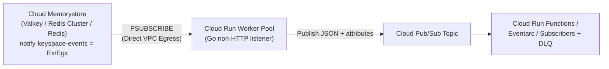

# Memorystore Keyspace Notifications → Cloud Pub/Sub Worker

Lightweight Go worker designed for **Cloud Run Worker Pools** that subscribes to **Cloud Memorystore** (Valkey, Redis Cluster, or Redis) keyspace notifications (`__keyevent@*__*` / `__keyspace@*__*`) and forwards them as structured JSON events to **Google Cloud Pub/Sub**.

## Architecture



### Key Design Notes

- **No native data-plane connector**: Google Cloud Eventarc for Memorystore covers control-plane/Audit Log events only. This worker bridges in-memory key events (`expired`, `del`, `evicted`, `set`) to Cloud Pub/Sub.
- **Cluster Mode Enabled support**: In Valkey multi-shard and Redis Cluster, keyspace notifications are **node-local** and not broadcast across shards. When `MEMORYSTORE_MODE=cluster`, the worker discovers all primary shards (`ForEachMaster`) and subscribes to each shard concurrently.
- **At-most-once semantics**: Redis/Valkey Pub/Sub is fire-and-forget. If you need producer-side persistence for application-emitted events, prefer **Valkey/Redis Streams** (`XADD` / `XREADGROUP`).

## Configuration (Environment Variables)

| Variable | Required | Default | Description |
| :--- | :---: | :--- | :--- |
| `MEMORYSTORE_ADDR` | Yes | — | `host:port` of Memorystore instance or cluster discovery endpoint |
| `MEMORYSTORE_MODE` | No | `standalone` | `standalone` (Valkey Cluster Disabled / Redis) or `cluster` (Valkey Cluster Enabled / Redis Cluster) |
| `MEMORYSTORE_USERNAME` | No | `""` | Optional ACL username |
| `MEMORYSTORE_PASSWORD` | No | `""` | Optional AUTH/ACL password (mount via Secret Manager in production) |
| `MEMORYSTORE_TLS_ENABLED` | No | `false` | Enable TLS in-transit encryption |
| `KEYSPACE_PATTERN` | No | `__keyevent@*__:*` | Pattern passed to `PSUBSCRIBE` |
| `AUTO_CONFIGURE_KEYSPACE_EVENTS` | No | `""` | Optional `CONFIG SET notify-keyspace-events` value (e.g. `Ex`, `Egx`) on startup |
| `PUBSUB_PROJECT_ID` | Yes | — | Google Cloud project ID hosting the Pub/Sub topic |
| `PUBSUB_TOPIC_ID` | Yes | — | Target Cloud Pub/Sub topic ID |
| `PUBLISH_TIMEOUT` | No | `10s` | Per-message Pub/Sub publish timeout |
| `LOG_LEVEL` | No | `info` | `debug`, `info`, `warn`, `error` |

## Local Validation & Tests

Unit and end-to-end tests use `miniredis` (no external Redis/Valkey server or GCP credentials required):

```bash
go test -v ./...
```

## Deploy to Cloud Run Worker Pools

Ensure `notify-keyspace-events` is enabled on your Memorystore instance (e.g. `Ex` for TTL expirations or `Egx` for expirations + evictions), then run:

```bash
chmod +x deploy/deploy.sh
PROJECT_ID="your-gcp-project" \
REGION="europe-west8" \
MEMORYSTORE_ADDR="10.0.0.5:6379" \
MEMORYSTORE_MODE="standalone" \
VPC_NETWORK="your-vpc" \
VPC_SUBNET="your-subnet" \
./deploy/deploy.sh
```

The script creates the Pub/Sub topic, a least-privilege Service Account (`roles/pubsub.publisher`), and deploys the container from source to `gcloud run worker-pools deploy` with Direct VPC Egress (`--vpc-egress=private-ranges-only`).
